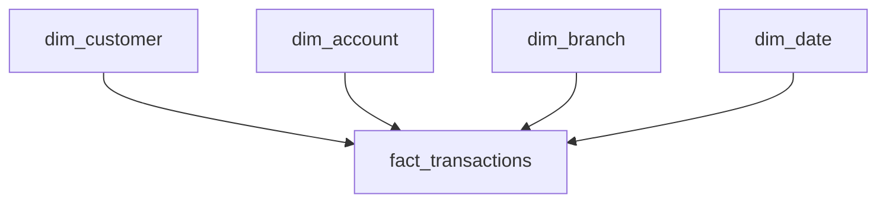

# FinPulse-Banking-Analytics

# FinPulse — Banking Customer & Financial Analytics

**A data analytics portfolio project using PostgreSQL, SQL, and Power BI.**

## Project Overview

FinPulse is an end-to-end banking analytics project built with synthetic data. It explores customer information, accounts, transactions, branches, and loans to demonstrate data preparation, SQL analysis, dimensional modelling, and business intelligence reporting.

## Business Objectives

- Monitor transaction volume and transaction value.
- Measure successful transactions and examine transaction statuses.
- Analyze customer activity and rank customers by transaction value.
- Compare branch-level transaction performance.
- Identify data quality issues before reporting.
- Organize transactional data into a dimensional warehouse for Power BI.

## Technology Stack

| Technology | Purpose |
|---|---|
| PostgreSQL | Relational database and data warehouse |
| SQL | Joins, aggregations, CTEs, window functions, and data validation |
| Power BI Desktop | KPI cards, charts, and interactive reporting |
| GitHub | Project documentation and version control |

## Dataset

The project uses synthetic banking data for educational and portfolio purposes.

| Table | Description |
|---|---|
| `branches` | Branch names and locations |
| `customers` | Customer details and contact information |
| `accounts` | Customer accounts, account types, and statuses |
| `transactions` | Transaction amounts, dates, channels, and statuses |
| `loans` | Loan information and interest rates |

The original database tables are stored in the `finpulse` schema.

## Data Quality Checks

The project includes checks for:

- Missing customer email addresses
- Negative account balances
- Invalid transaction amounts
- Unexpected transaction statuses
- Invalid loan interest rates
- Transactions without matching account records

These checks help identify data issues before downstream analysis.

## SQL Analysis

The analytical queries explore:

- Monthly transaction trends
- Transaction performance by branch
- Customer ranking using window functions
- Customer recency, frequency, and monetary (RFM) metrics
- Data quality and referential integrity

## Data Warehouse Design

The warehouse is organized in the `finpulse_dw` schema using dimension tables and a transaction fact table.

### Dimension tables

- `dim_customer` — customer attributes
- `dim_branch` — branch attributes
- `dim_account` — account attributes
- `dim_date` — calendar attributes

### Fact table

- `fact_transactions` — transaction records, amounts, statuses, and keys linking to dimensions

### Star-schema overview



The fact table connects to the dimensions through keys, allowing transaction measures to be analyzed by customer, account, branch, and date.

## Power BI Dashboard

The current report includes KPI cards for:

- Total transaction value
- Total transactions
- Successful transactions

It also includes a transaction-status chart.

Dashboard screenshots and the Power BI report file can be added to this repository as the project is finalized.

## Repository Structure

```text
FinPulse-Banking-Analytics/
├── README.md
└── FinPulse_Beginner_Project/
    └── FinPulse/
        ├── data files
        └── other project files
```

The exact folder contents may vary as SQL scripts, dashboard files, and screenshots are added.

## How to Explore the Project

1. Review the synthetic CSV datasets.
2. Load the source tables into PostgreSQL.
3. Run the SQL data-quality and analytical queries.
4. Explore the dimensional warehouse in `finpulse_dw`.
5. Open the Power BI report in Power BI Desktop when the `.pbix` file is available.

## Skills Demonstrated

SQL analytics · PostgreSQL · Data quality validation · Dimensional modelling · Star schema · KPI reporting · Power BI

## Disclaimer

This is an educational portfolio project using synthetic data. It does not contain real customer banking records and is not intended for actual financial decision-making.
